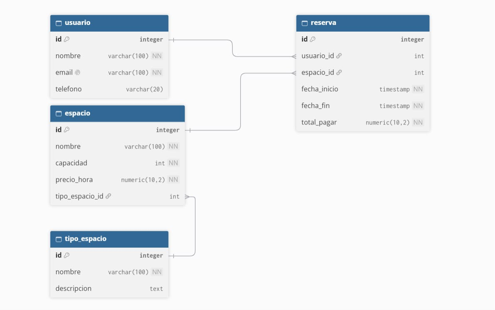

# Proyecto integrador B1-2026-2 G2

## Resumen Ejecutivo
Esta es una plataforma web para gestionar los usuarios, espacios y reservas de un coworking.
Sirve para llevar un control de los registros desde una interfaz gráfica sencilla que se conecta directamente a la base de datos.

## Arquitectura
El proyecto se divide en varias capas para mantener el orden:
* Frontend: la interfaz visual (Vaadin).
* Backend: la lógica y el acceso a datos (Spring Boot).
* Base de datos: almacenamiento de la información (PostgreSQL).

## Diagrama MER
A continuación se muestra el modelo entidad-relación de la base de datos:

